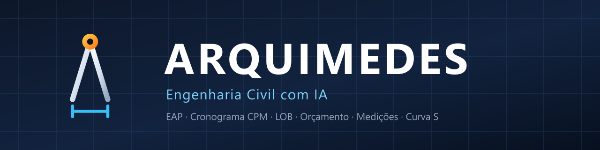

<p align="center">
  
</p>

<p align="center">
  
  &nbsp;
  
  &nbsp;
  
</p>

<p align="center"><b>Arquimedes — o assistente de IA do escritório de Engenharia Civil.</b></p>

<p align="center">
  <a href="https://github.com/ragomes102030-cpu/ArquimedesPlanejamento/releases/latest" target="_blank">⬇️ Baixar a versão mais recente</a>
  &nbsp;·&nbsp;
  <a href="#instalação">Instalar</a>
  &nbsp;·&nbsp;
  <a href="../../docs/ROADMAP_ENGENHARIA_CIVIL.md">Roadmap de Engenharia Civil</a>
</p>

---

## O que é o Arquimedes

O Arquimedes é uma plataforma de IA para **Engenharia Civil**. Ele reúne, em um aplicativo de
desktop (Windows, macOS e Linux) e também na web, os agentes, as ferramentas e os dados que um
escritório de projetos precisa para planejar, orçar, medir e controlar a obra.

O diferencial do Arquimedes não é "ter uma IA conversando". É a **auditoria matemática** por trás
de cada resposta: quando o Arquimedes afirma que uma obra está atrasada, ele mostra o caminho
crítico, a curva S, o EAC e a memória de cálculo que sustentam a conclusão.

### Para quem é

| Perfil | O que o Arquimedes resolve |
|---|---|
| **Engenheiro pleno / Jr.** | Importar cronograma, rodar CPM, achar o caminho crítico e gerar o relatório em minutos |
| **Planejador de obras** | Curva S, linha de balanço, replanejamento com comparação de cenários, detecção de interferência |
| **Orcamentista** | Quantitativos, BDI, proposta comercial, comparação com SINAPI/SEINFRA |
| **Gestor / dono** | Medição mensal, TVI, EVM, EAC/VAC, painel de portfólio multi-obra |
| **Fiscal / supplying** | RDO com evidência (foto geolocalizada + clima), trilha de auditoria, memória de cálculo |

### O que já existe hoje

- **Agentes de IA** com memória de conversa, ferramentas, skills e execução de tarefas agendadas.
- **WebUI** para acessar o mesmo workspace pelo navegador, inclusive em obra (rede lenta).
- **MCPs de engenharia** — as ferramentas de cálculo ficam expostas como *Model Context Protocol*,
  então qualquer agente (não só o do Arquimedes) pode usá-las:
  - `eap-orchestration` — cria e audita a **EAP/WBS** de forma hierárquica e consistente
  - `obra` — quantitativos, orçamento e dados da obra
  - `gantt` — cronograma, CPM e caminho crítico
  - `sinapi-seinfra` — tabelas oficiais de custo (SINAPI, SEINFRA-CE, EMOP) para precificação
  - `weather-construction` — previsão de chuva via Open-Meteo, sem chave de API
- **Skills de engenharia** — `obra-dados` (curva S, EVM, EAC/VAC com saída em XLSX),
  `planejamento-obras-engenharia`, `sinapi-seinfra`, `weather-construction`, `cad-planta-autocad`.
- **Auditoria de cronograma como gate**: divergências entre o CPM do app e o do arquivo original
  acima de 1 hora são tratadas como erro bloqueante, não como simples aviso.

---

## Roadmap de Engenharia Civil

O plano completo de evolução — benchmark de mercado, lacunas (G1–G10), backlog do H1 ao H3,
quick wins e as decisões de kick-off — está em
**[`docs/ROADMAP_ENGENHARIA_CIVIL.md`](../../docs/ROADMAP_ENGENHARIA_CIVIL.md)**.

| Horizonte | Foco |
|---|---|
| **Quick wins** (2–4 semanas) | Painel de Curva S nativo no app · modelo de proposta comercial (SINAPI/BDI) · RDO com clima e foto · checklist de medição · comparador de cronograma · readme em português |
| **H1** (0–3 meses) | Importador de cronograma (MSP/XER/XML P6/CSV) com CPM auditado · importador de orçamento (OrçaFas/SicOn/Excel) · medição mensal com certificado PDF · TVI · painel de obra |
| **H2** (3–9 meses) | Motor BIM/IFC: 4D e 5D, IFC no navegador via WebAssembly, clash detection |
| **H3** (9–18 meses) | App de canteiro · painel de portfólio multi-obra · fluxo comercial ponta a ponta · assinatura digital e trilha de auditoria · integração ERP |

### Leitura de mercado

O mercado se divide em três frentes — quem **vê** a obra (OpenSpace, Buildots), quem
**quantifica** (Togal.AI, Trunk Tools) e quem **controla** o financeiro (Mais Controle,
BuildMind, Obrasgov.br). **Ninguém entrega as três com auditoria matemática do cronograma.**
O Arquimedes ocupa a terceira frente, com vantagem na segunda e, via MCP aberto, conecta-se à
primeira.

---

## Instalação

### Requisitos

- **Windows** 10/11 (x64) · **macOS** 11+ · **Linux** (x64)
- ~500 MB livres em disco
- Node.js 20+ apenas se for desenvolver a partir do código

### Baixar o instalador

1. Vá em [Releases](https://github.com/ragomes102030-cpu/ArquimedesPlanejamento/releases/latest)
   e baixe `Arquimedes-<versão>-win-x64.exe` (ou o pacote do seu sistema).
2. Execute e siga o assistente (você escolhe a pasta de instalação).
3. Abra o Arquimedes.

### Atualização automática

O app verifica atualizações sozinho. O canal público fica em
`https://github.com/ragomes102030-cpu/ArquimedesPlanejamento/releases/latest`.

### WebUI

Para rodar só a interface web (útil em obra, em notebook ou no celular):

```bash
npm run webui:start
```

### A partir do código

```bash
git clone https://github.com/ragomes102030-cpu/ArquimedesPlanejamento.git
cd ArquimedesPlanejamento
npm install
npm run dev
```

Guia completo de desenvolvimento: [`docs/contributing/development.md`](../../docs/contributing/development.md).

---

## Primeiros passos em 3 passos

1. **Converse com a EAP.** Peça: *"Monte a EAP desta obra"* e descreva o escopo — o Arquimedes
   monta a árvore hierárquica e devolve o cronograma.
2. **Traga o cronograma real.** Importe o arquivo do MS Project / Primavera / P6 e peça para o
   app auditar o CPM: caminho crítico, folgas e conflitos de predecessora.
3. **Feche a medição.** Gere a medição mensal com memória de cálculo, TVI e o EAC/VAC do projeto.

---

## Documentação

| Documento | Conteúdo |
|---|---|
| [`docs/ROADMAP_ENGENHARIA_CIVIL.md`](../../docs/ROADMAP_ENGENHARIA_CIVIL.md) | Plano de evolução para Engenharia Civil |
| [`docs/guides/webui.md`](../../docs/guides/webui.md) | Usando a interface web |
| [`docs/guides/deploy-server.md`](../../docs/guides/deploy-server.md) | Publicando o servidor do WebUI |
| [`docs/contributing/development.md`](../../docs/contributing/development.md) | Ambiente de desenvolvimento |
| [`COMO_PUBLICAR_VERSAO.md`](../../COMO_PUBLICAR_VERSAO.md) | Como gerar e publicar uma versão |
| [`CHANGELOG.md`](../../CHANGELOG.md) | Histórico de versões |

---

## Contribuindo

Issues e discussions são bem-vindas — especialmente as que descrevem um problema real de obra.

- 🐛 [Abrir uma issue](https://github.com/ragomes102030-cpu/ArquimedesPlanejamento/issues)
- 💬 [Discussões](https://github.com/ragomes102030-cpu/ArquimedesPlanejamento/discussions)
- 🛠️ [Guia de contribuição](../../docs/contributing/development.md)

---

## Licença

Apache License 2.0 — veja [`LICENSE`](../../LICENSE).

O Arquimedes deriva do projeto open source **AionUi** (Apache-2.0), que serve de base para a
camada de agentes, CLI desktop e infraestrutura de workspaces.

---

<p align="center">
  <sub>Compasso e linha de cota — porque todo projeto de engenharia começa com uma medida.</sub>
</p>
